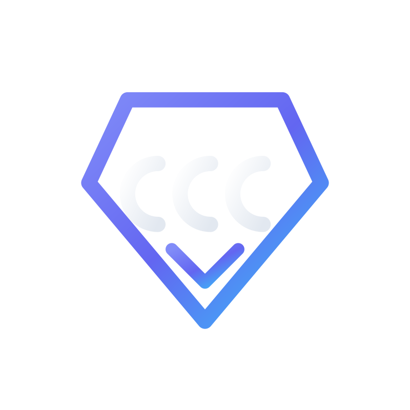

<p align="center">
<a href="https://comparecloudcosts.com/yourcloud"></a>
</p>

# Compare Cloud Costs — MCP Server

A standalone [Model Context Protocol](https://modelcontextprotocol.io) server that gives your AI assistant access to the [Compare Cloud Costs](https://comparecloudcosts.com) pricing catalog — cloud and AI model pricing across AWS, Azure, Google Cloud, Oracle, DigitalOcean, Alibaba, Cloudflare and the frontier AI providers, aligned to the FinOps FOCUS™ standard.

**Data freshness:** CCC refreshes its pricing information about once a week. The catalog is not real-time or live data, so use it for planning and comparison rather than minute-by-minute price checks.

This package is the installable, stdio-transport MCP server. Tool names and schemas match the canonical catalog used by the Compare Cloud Costs backend, and every tool is backed by the site's real public APIs — no sample data.

## Tools

| Tool | What it does |
| --- | --- |
| `compare_cloud_pricing` | Query and compare multi-cloud compute, database, and serverless pricing across AWS, Azure, Google Cloud, Oracle, DigitalOcean, Alibaba, and Cloudflare. Filters: `category` (required), `provider`, `min_vcpu`, `min_ram_gb`, `region`. |
| `search_ai_models` | Search token pricing (input, output, prompt caching) and context windows for AI LLMs across OpenAI, Anthropic, DeepSeek, Mistral, Meta Llama, and Cohere. Filters: `provider`, `model_family`. |
| `estimate_workload_architecture` | End-to-end multi-cloud monthly cost benchmarks for realistic full-stack architectures (VMs + managed DB + load balancers + storage + egress). Takes a `workload_id` (see below). |
| `lookup_datacenter_compliance` | Checks global data center availability and region locations from the pricing catalog, with pointers to certification details. Filters: `compliance_standard`, `country_or_city`. |

### Workload IDs

`estimate_workload_architecture` accepts the workload slugs from https://comparecloudcosts.com/workloads, e.g. `3-tier-web`, `serverless-web-app`, `rag-ai-app`, `k8s-app-platform`, `ecommerce-microservices`, `streaming-analytics`, `data-warehouse-bi`, `ml-training-hosting`, `agentic-ai-swarm`. (The example slugs in the tool description — `three-tier-web-app`, `ai-rag-pipeline`, etc. — predate the current catalog; if an ID is unknown the tool returns the list of valid IDs.)

## Get a free API key

Tool calls need a free Compare Cloud Costs API key:

1. Go to **https://comparecloudcosts.com/mcp** and click **Generate preview key** (1-click, no card). Keys look like `ccc_live_…`.
2. Set it as the `CCC_API_KEY` environment variable in your MCP client config (see below).

`tools/list` works without a key; `tools/call` returns an error explaining how to get one. Free preview keys are rate-limited per hour (the remaining quota is reported in tool responses).

## Install

### Claude Desktop

Add to `claude_desktop_config.json` (macOS: `~/Library/Application Support/Claude/claude_desktop_config.json`; Windows: `%APPDATA%\Claude\claude_desktop_config.json`):

```json
{
  "mcpServers": {
    "compare-cloud-costs": {
      "command": "npx",
      "args": ["-y", "@comparecloudcosts/mcp-server"],
      "env": {
        "CCC_API_KEY": "ccc_live_your_key_here"
      }
    }
  }
}
```

### Cursor

Add to `~/.cursor/mcp.json` (or a project `.cursor/mcp.json`):

```json
{
  "mcpServers": {
    "compare-cloud-costs": {
      "command": "npx",
      "args": ["-y", "@comparecloudcosts/mcp-server"],
      "env": {
        "CCC_API_KEY": "ccc_live_your_key_here"
      }
    }
  }
}
```

### VS Code

Add to `.vscode/mcp.json` (note VS Code uses the `servers` key):

```json
{
  "servers": {
    "compare-cloud-costs": {
      "command": "npx",
      "args": ["-y", "@comparecloudcosts/mcp-server"],
      "env": {
        "CCC_API_KEY": "ccc_live_your_key_here"
      },
      "type": "stdio"
    }
  }
}
```

Requires Node.js ≥ 18.

## How the tools map to the real API

All pricing data comes from `GET https://comparecloudcosts.com/api/v1/pricing` with header `X-API-Key: <CCC_API_KEY>` (documented in the "Public API" section of https://comparecloudcosts.com/docs). The endpoint is a faceted filter over the pricing database; the mappings below follow its server-side filter semantics exactly.

### `compare_cloud_pricing`

| Tool argument | API parameter | Notes |
| --- | --- | --- |
| `category` | `product` | The API has **no** category filter that accepts these values — its `category` parameter matches per-record labels like "General purpose". The category lens is the `product` parameter: `vm→compute`, `database→database`, `serverless→serverless`, `storage→storage`, `ai→ai`, `gpu→gpu`, `containers→containers`, `app-hosting→app-hosting`. (The API also special-cases `gpu` to GPU instances only, and `compute` to non-GPU.) Skipping this mapping would silently default every query to `compute`. |
| `provider` | `provider` | Provider slugs pass through unchanged (`aws`, `azure`, `gcp`, …). |
| `min_vcpu` | `minVcpu` | Numeric minimum. |
| `min_ram_gb` | `minMemory` | Numeric minimum, GB. |
| `region` | `geography` | The API has no region-slug parameter. Region IDs (`us-east-1`, `eu-west-1`, `sa-east-1`), Azure location names, and place names are translated to the API's geography buckets (`north america`, `south america`, `europe`, `asia pacific`, `middle east & africa`). Bucket values are sent **lowercase** — the API compares them against `LOWER(geography)` without lowercasing its input (verified against the production API). `global`/empty means no geography filter. Unrecognized strings pass through. |

Results are ordered by price ascending (cheapest first) by the API. The server requests a 500-record page and returns the total count plus the 50 lowest-priced records, trimmed to the comparison-relevant fields.

### `search_ai_models`

`product=ai` plus `provider` (passed through) and `model_family` → the API's free-text `search` parameter. Records are returned with their `attributes` (modality, model tier, etc.); token prices are per the record's `unit` (typically per 1M tokens).

### `estimate_workload_architecture`

Wired to the site's real estimator: `POST https://comparecloudcosts.com/api/workloads` with `{ "workloadId": "<id>" }`, which returns per-provider monthly totals and a component breakdown (instance types, quantities, monthly prices) computed from catalog pricing records (refreshed about once a week). The tool returns those totals and components as-is. Unknown IDs return the API's "Workload not found" plus the list of valid IDs — numbers are never invented.

All 36 site architecture templates are supported:

| Workload Name | Canonical Slug | Description |
| --- | --- | --- |
| Serverless Fallback & Resiliency Buffer | `serverless-fallback-buffer` | A resilient middleware buffer placed in front of serverless functions. Catches traffic spikes or cold-start timeouts by queuing requests into a persistent queue, caching session state, and dispatching to a failover VM worker pool. |
| AI Gateway, Guardrails & Caching Proxy | `ai-gateway-proxy` | An enterprise middleware proxy positioned between internal applications and external LLM vendors. Enforces prompt security guardrails (WAF), performs semantic prompt caching, rate-limits tenant requests, and manages API keys securely. |
| Enterprise API Gateway & Auth Middleware | `api-rate-limiting-auth-gateway` | A standalone security & integration middleware layer placed in front of legacy or internal microservices to handle OAuth token validation, IP rate-limiting, TLS termination, and traffic shaping. |
| Cross-Cloud Event Router & Message Broker | `cross-cloud-event-router` | A cross-cloud middleware layer connecting disparate applications across AWS, Azure, GCP, and hybrid environments, converting event schemas and guaranteeing asynchronous delivery. |
| RAG AI Application | `rag-ai-app` | A generative AI application using a Foundational Model connected to a Vector Database to search proprietary documents and return grounded answers. |
| Containerized API via Load Balancer (ALB + Containers) | `container-api-alb` | Exposes a containerized orders & payments API directly behind an internet-facing Application Load Balancer (Client → ALB → Managed Containers → Database) without an API Gateway. ALB handles path-based routing (/orders, /payments), target group health checks, traffic distribution, TLS termination, and native OIDC/JWT verification. |
| Serverless HTTP API (HTTP Gateway + Functions + NoSQL) | `serverless-http-api` | A lean, low-cost serverless API pattern (Client → HTTP API Gateway → Serverless Functions → Managed NoSQL) featuring a native JWT authorizer, stage- and route-level throttling, and built-in CORS — with no load balancer or idle compute to provision. |
| External Partner API (REST Gateway + Internal ALB + Containers) | `external-partner-rest-api` | A managed external partner API architecture (Partner → REST API Gateway → VPC Link V2 → Internal ALB → Managed Containers → Database). Combines REST API keys, per-client usage plans and quotas, request validation/transformation, and direct WAF integration at the edge with an internal ALB for private container health checks and traffic distribution. |
| Serverless Web Application | `serverless-web-app` | A scalable, low-maintenance backend without provisioning servers. Perfect for event-driven web and mobile backends. |
| Classic 3-Tier Web Architecture | `3-tier-web` | The foundational blueprint for monolithic or traditionally scaled web applications using VMs and relational databases. The deliberate minimal baseline. |
| Real-time Streaming Analytics | `realtime-streaming-analytics` | A highly demanded architecture for processing IoT telemetry, clickstreams, or financial data in real time. |
| E-Commerce Microservices Stack | `ecommerce-microservices` | A resilient, decoupled architecture designed for high availability, fast product lookups, and fault tolerance. |
| ML Training & Hosting | `ml-training-hosting` | A pipeline for training machine-learning models on GPU clusters and serving them through a managed inference endpoint. |
| Kubernetes App Platform | `k8s-app-platform` | A general-purpose container platform for running microservices and stateful applications on managed Kubernetes. |
| HPC / Scientific Computing | `hpc-scientific` | A high-performance computing cluster for simulations, modeling, and batch scientific workloads. |
| SaaS on Managed Platform | `saas-paas-app` | A multi-tenant SaaS product running on a managed application platform (PaaS) with a relational backend. |
| Data Warehouse & BI | `data-warehouse-bi` | A cloud data warehouse feeding business-intelligence dashboards, fed by an ETL pipeline. |
| 11-Layer Defense-in-Depth Production Architecture (Multi-AZ Analytics & Containers) | `defense-in-depth-analytics-platform` | A production-grade 11-layer, Multi-AZ architecture demonstrating defense-in-depth from edge to data layer: Edge DDoS/DNS/TLS/GuardDuty/KMS, Layer-7 WAF, dual public ALBs (Shiny & RStudio), private ECS Fargate + EC2 Auto Scaling container fleets with outbound egress filtering, PrivateLink VPC isolation, SFTP (Transfer Family) + direct S3 ingestion, DataSync, shared EFS storage, and serverless SQL analytics (Athena via JDBC). |
| Disaster Recovery (Warm Standby) | `disaster-recovery` | A cross-region warm-standby environment that can take over if the primary region fails. |
| Content & Media Platform | `content-media-platform` | A video/media platform that transcodes uploads and delivers content globally through a CDN. |
| Compliance-Ready Web Application | `compliance-ready-web-app` | A 3-tier web app hardened with managed security services for teams in regulated industries handling sensitive data. Security add-ons scale with the Security slider. |
| RAG AI Knowledge Base | `rag-ai-knowledge-base` | A retrieval-augmented generation pipeline for AI chat and search — document storage, a metadata store, an API layer, embeddings, orchestration, and a managed inference endpoint. |
| Smart Manufacturing (IIoT) | `smart-manufacturing` | An Industrial IoT (IIoT) platform for real-time sensor analytics — edge collection, stream ingestion, live metrics storage, historical analytics, and predictive maintenance. |
| Event-Driven Image Processing | `event-driven-image-processing` | An event-driven architecture that processes uploaded images (e.g., ID verification, insurance claims) by triggering serverless functions to run AI vision models and store the extracted metadata. |
| Hybrid Cloud Network Backbone | `hybrid-cloud-network` | A robust networking architecture connecting on-premises data centers to cloud resources via dedicated connections and secure gateways. |
| Zero-Trust Enterprise Edge | `zero-trust-edge` | A secure, global entry point that strictly authenticates all users and devices, mitigating bots and edge threats before traffic hits the application. |
| Event-Driven API Backend | `event-driven-api` | An agile, fully serverless microservices backend combining managed API gateways, message queues, and rapid cache lookups. |
| Voice AI Assistant | `voice-ai-assistant` | A speech-to-speech AI pipeline — incoming audio is transcribed, interpreted by a conversational LLM, and answered with a synthesized voice reply. Showcases how AI modality (Audio vs. Chat) and capability tier (Frontier vs. Standard) drive different AI product rows within one architecture. |
| Autonomous Agent Swarm | `agentic-ai-swarm` | A distributed multi-agent system where specialized AI agents autonomously collaborate, route tasks via message queues, and share transient state in memory. |
| Distributed Saga & Compensating Workflows | `saga-orchestrated-ecommerce` | Coordinates multi-service distributed transactions (e.g. Order → Payment → Inventory) using an orchestrator state machine. When a downstream step fails (such as stockout), automatically triggers compensating undo actions (payment refund, order cancellation) without distributed locks. |
| Transactional Outbox & Stream Relay | `transactional-outbox-cdc` | Guarantees reliable dual writes between relational databases and event brokers. Orders and outbox events commit in a single ACID transaction, while a dedicated Change Data Capture (CDC) worker stream-relays messages to the event bus with zero message loss. |
| Partitioned Pub/Sub with Consumer Groups | `partitioned-pubsub-consumer-groups` | Scales event-driven task distribution across independent downstream systems (Email, Inventory, Analytics). Hash-keyed partitioning preserves strict per-entity ordering while competing consumer groups scale throughput horizontally with Redis idempotency guards. |
| CQRS & Event Sourcing Architecture | `cqrs-event-sourcing` | Separates write commands from read queries for optimal scaling and zero-data-loss auditability. Changes are recorded to an append-only event store, and asynchronous projection stream workers continuously update read-optimized materialized views. |
| CDC-Driven Cache Invalidation & Event Sync | `cdc-cache-invalidation` | Eliminates cache-aside race conditions, app-crash inconsistencies, and stale data by tailing database Write-Ahead Logs (WAL/binlog) via Change Data Capture (CDC). Stream events are consumed by an event-driven worker that evicts or refreshes affected keys directly in a distributed in-memory cache. |
| Multi-Tier Layered Caching Architecture | `multi-tier-caching-web-stack` | A high-throughput, latency-optimized web stack employing a 3-tier caching hierarchy: Edge CDN (static assets & public HTTP caching), container in-process micro-cache (L1 with jittered TTLs), and a shared distributed cache (L2 Redis/Valkey cluster with stampede mutex locks) shielding transactional database read replicas. |
| Customer Portal | `customer-portal` | A secure customer-facing portal — authenticated sign-in, edge protection, serverless APIs for spiky traffic, core services on Kubernetes, orders and payments with compensating workflows, managed relational + NoSQL data. |

#### Backward Compatibility & Aliases
Every slug accepted previously by the MCP server remains functional via automatic alias resolution:
- `streaming-analytics` → mapped to `realtime-streaming-analytics`
- `three-tier-web-app` & `three-tier-web` → mapped to `3-tier-web`
- `ai-rag-pipeline` → mapped to `rag-ai-app`
- `high-throughput-api` → mapped to `container-api-alb`
- `batch-processing` → mapped to `hpc-scientific`

### `lookup_datacenter_compliance`

Regional availability is computed from the site's facets endpoint, `GET https://comparecloudcosts.com/api/facets?product=compute[&geography=…]` (the same endpoint that powers the website's filter sidebar), which returns catalog-wide record counts per geography and per provider with proper faceted-search semantics. This is deliberately **not** derived from a sample of pricing records — the pricing endpoint returns records cheapest-first, which badly under-reports non-US geographies.

**Honest limitation:** per-datacenter compliance certifications (SOC 2, ISO 27001, HIPAA, PCI-DSS, FedRAMP, GDPR) are **not** exposed by any public API — the pricing records carry no certification fields. When a `compliance_standard` is requested, the tool says so explicitly and points to https://comparecloudcosts.com/datacenters and https://comparecloudcosts.com/compliance instead of fabricating coverage.

Also note: at the time of writing, the catalog's geography tagging for compute records is concentrated in North America (with a small Asia Pacific set), so geography-filtered queries for other regions may return zero records. That is the catalog's real coverage, reported as-is.

## Development

```bash
npm install
npm run build
npm start            # stdio server on dist/index.js
node test/smoke.mjs  # optional smoke test (set CCC_SMOKE_KEY to include API calls)
```

## Registry / directory files

- `server.json` — official MCP Registry manifest (`com.comparecloudcosts/mcp-server`); the matching `mcpName` field is in `package.json`, as the Registry requires.
- `glama.json` — Glama ownership-claim file (maintainer: the repository owner).

## License

MIT

---

<p align="center">© 2026 Cosell Plus LLC. Compare Cloud Costs™ is a product of Cosell Plus LLC. All rights reserved.</p>
