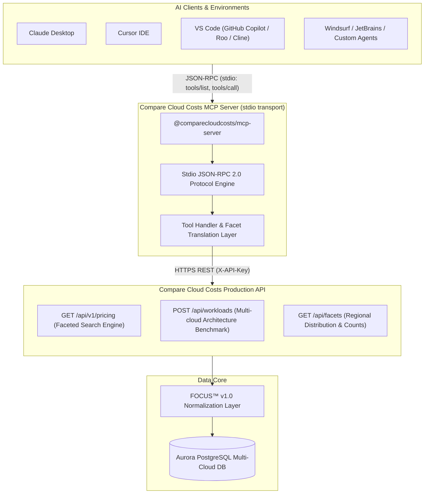
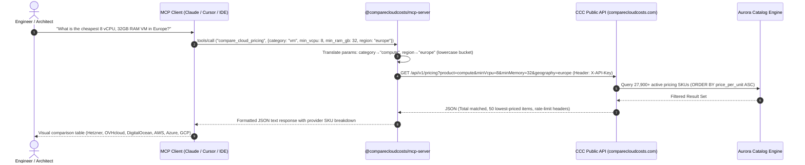

# Compare Cloud Costs — Model Context Protocol (MCP) Server Guide

A comprehensive, production-grade guide for developers, platform engineers, and enterprise organizations on how to install, configure, secure, and leverage the **Compare Cloud Costs (CCC) MCP Server** within modern AI coding assistants and autonomous agent workflows.

---

## 1. Executive Summary & Architecture Overview

The **Compare Cloud Costs MCP Server** implements the [Model Context Protocol (MCP)](https://modelcontextprotocol.io) open standard (stdio transport). It connects large language models directly to the live CCC cloud catalog, enabling AI assistants to perform real-time FinOps pricing comparisons, model token evaluations, and architecture cost modeling without leaving the IDE or chat interface.

### Published Package & Ecosystem Distribution

| Distribution Channel | Identifier / Endpoint | Status | Verification & Target |
| :--- | :--- | :--- | :--- |
| **npm Registry** | [`@comparecloudcosts/mcp-server@1.0.0`](https://www.npmjs.com/package/@comparecloudcosts/mcp-server) | Active (Public) | Standard package manager distribution (`npx -y`) |
| **GitHub Repository** | [`rodrigo-orzari/ccc-mcp-server`](https://github.com/rodrigo-orzari/ccc-mcp-server) | Active (Public) | Source code, `server.json`, open-source contributions |
| **mcpservers.org** | [`mcpservers.org/servers/comparecloudcosts-com-mcp`](https://mcpservers.org/servers/comparecloudcosts-com-mcp) | Approved & Live | Community discovery portal |
| **Glama Directory** | [`glama.ai/mcp/servers/rodrigo_orzari/ccc-mcp-server`](https://glama.ai/mcp/servers/rodrigo_orzari/ccc-mcp-server) | Indexed & Live | Standard directory (maintainer verification via GitHub OAuth) |
| **Official Portal** | [comparecloudcosts.com/mcp](https://comparecloudcosts.com/mcp) | Production Web | Key generation, live schema viewer, and interactive docs |

---

### High-Level Architecture Diagram



---

## 2. Server Capabilities & Tool Reference

The MCP server exposes 4 tools designed for enterprise FinOps, architecture planning, and capacity estimation:

| Tool Name | Key Parameters | Functionality |
| :--- | :--- | :--- |
| `compare_cloud_pricing` | `category` *(required)*, `provider`, `min_vcpu`, `min_ram_gb`, `region` | Queries multi-cloud compute, database, storage, and serverless pricing across AWS, Azure, Google Cloud, Oracle, DigitalOcean, Alibaba, and Cloudflare. Automatically orders by price ascending. |
| `search_ai_models` | `provider`, `model_family` | Retrieves context window sizes and token pricing (input, output, prompt caching) across OpenAI, Anthropic, DeepSeek, Mistral, Meta Llama, and Cohere. |
| `estimate_workload_architecture` | `workload_id` *(required)* | Evaluates full-stack architectures (e.g. `3-tier-web`, `rag-ai-app`, `k8s-app-platform`, `streaming-analytics`) and generates a comparative bill of materials across all supported clouds. |
| `lookup_datacenter_compliance` | `compliance_standard`, `country_or_city` | Audits regional availability and geographical data center locations across 24 global providers. |

---

## 3. Tool Execution Flow (End-to-End Sequence)



---

## 4. Step-by-Step Setup & Client Configuration

### Step 1: Generate an API Key

1. Navigate to [comparecloudcosts.com/mcp](https://comparecloudcosts.com/mcp).
2. Click **Generate preview key** (one-click activation, no credit card required).
3. Copy your live key formatted as:
   ```text
   ccc_live_xxxxxxxxxxxxxxxxxxxxxxxx
   ```

> [!NOTE]
> `tools/list` requires no credentials. `tools/call` requires a valid `CCC_API_KEY` passed via the environment. Free preview keys carry an hourly rate-limit quota, reported in the metadata response.

---

### Step 2: Configure Your Client

#### A. Claude Desktop

Edit your Claude Desktop configuration file:
- **macOS**: `~/Library/Application Support/Claude/claude_desktop_config.json`
- **Windows**: `%APPDATA%\Claude\claude_desktop_config.json`
- **Linux**: `~/.config/Claude/claude_desktop_config.json`

```json
{
  "mcpServers": {
    "compare-cloud-costs": {
      "command": "npx",
      "args": [
        "-y",
        "@comparecloudcosts/mcp-server"
      ],
      "env": {
        "CCC_API_KEY": "ccc_live_YOUR_API_KEY_HERE"
      }
    }
  }
}
```

*Restart Claude Desktop after saving.*

---

#### B. Cursor IDE

1. Open Cursor and navigate to **Cursor Settings** → **Features** → **MCP**.
2. Click **+ Add New MCP Server**.
3. Fill in the modal:
   - **Name**: `compare-cloud-costs`
   - **Type**: `command`
   - **Command**: `npx -y @comparecloudcosts/mcp-server`
4. Alternatively, add directly to `~/.cursor/mcp.json` or `.cursor/mcp.json` in your workspace root:

```json
{
  "mcpServers": {
    "compare-cloud-costs": {
      "command": "npx",
      "args": ["-y", "@comparecloudcosts/mcp-server"],
      "env": {
        "CCC_API_KEY": "ccc_live_YOUR_API_KEY_HERE"
      }
    }
  }
}
```

---

#### C. Visual Studio Code (Roo Code / Cline / GitHub Copilot)

Add the configuration to `.vscode/mcp.json` (or global user settings):

```json
{
  "servers": {
    "compare-cloud-costs": {
      "type": "stdio",
      "command": "npx",
      "args": ["-y", "@comparecloudcosts/mcp-server"],
      "env": {
        "CCC_API_KEY": "ccc_live_YOUR_API_KEY_HERE"
      }
    }
  }
}
```

---

#### D. Windsurf / Codeium Cascade

Add to `~/.codeium/windsurf/mcp_config.json`:

```json
{
  "mcpServers": {
    "compare-cloud-costs": {
      "command": "npx",
      "args": ["-y", "@comparecloudcosts/mcp-server"],
      "env": {
        "CCC_API_KEY": "ccc_live_YOUR_API_KEY_HERE"
      }
    }
  }
}
```

---

## 5. Enterprise Self-Hosting & Publishing Runbook

For corporate security teams requiring private npm registries, local compilation, or private fork hosting:

### A. Local Build & Run

```bash
# 1. Clone the repository
git clone https://github.com/rodrigo-orzari/ccc-mcp-server.git
cd ccc-mcp-server

# 2. Install dependencies (Node.js >= 18 required)
npm install

# 3. Compile TypeScript
npm run build

# 4. Run the stdio server directly
export CCC_API_KEY="ccc_live_YOUR_KEY"
node dist/index.js
```

### B. Verification Smoke Test

Run the included automated smoke test to verify stdio protocol responses and API connectivity:

```bash
CCC_SMOKE_KEY="ccc_live_YOUR_KEY" node test/smoke.mjs
```

Expected output:
```text
✓ Initialized stdio handshake
✓ tools/list: 4 tools discovered
✓ compare_cloud_pricing: 200 OK (50 SKUs returned)
✓ search_ai_models: 200 OK
✓ estimate_workload_architecture: 200 OK
✓ lookup_datacenter_compliance: 200 OK
All smoke tests passed.
```

---

## 6. Directory Publishing & Ownership Claim Guide

### 1. Official MCP Registry (`server.json`)
The repository includes an official `server.json` manifest following the Anthropic / MCP Registry standard:
- Namespace: `com.comparecloudcosts/mcp-server`
- Package definition: Matches the `mcpName` property in `package.json`.
- Automatic CI ingestion: Monitored by the official modelcontextprotocol registry scrapers.

### 2. Glama Marketplace (`glama.json`)
The server is indexed at [`glama.ai/mcp/servers/rodrigo_orzari/ccc-mcp-server`](https://glama.ai/mcp/servers/rodrigo_orzari/ccc-mcp-server).

**To complete the maintainer ownership claim:**
1. Navigate to the server listing on [Glama](https://glama.ai/mcp/servers/rodrigo_orzari/ccc-mcp-server).
2. Click **Claim Ownership** in the maintainer banner.
3. Authenticate with the GitHub account owning `rodrigo-orzari/ccc-mcp-server`.
4. Glama verifies the repository root file `glama.json`:
   ```json
   {
     "$schema": "https://glama.ai/mcp/schemas/server.json",
     "maintainers": ["rodrigo-orzari"]
   }
   ```
5. Once confirmed, the listing will display the verified maintainer badge.

### 3. mcpservers.org Listing
- **Listing URL**: `https://mcpservers.org/servers/comparecloudcosts-com-mcp`
- Status: **Approved & Live**.
- Updates are pulled automatically from releases and tags published to `@comparecloudcosts/mcp-server` on npm.

---

## 7. Example Prompts & Use Cases

Once connected, engineers can interact naturally with their AI assistant:

### Scenario 1: Multi-Cloud VM Sizing
> *"Compare general purpose VMs with at least 16 vCPUs and 64 GB of RAM across AWS, Azure, and Google Cloud in Europe. Which one offers the best hourly rate?"*

### Scenario 2: LLM Token Cost Optimization
> *"We are building an agent that makes heavy use of prompt caching and high token throughput. Can you compare Anthropic Claude 3.5 Sonnet, OpenAI GPT-4o, and DeepSeek V3 in terms of input, cached input, and output token costs?"*

### Scenario 3: End-to-End Architecture Estimation
> *"We're planning a production RAG application. Can you estimate the monthly infrastructure costs using the `rag-ai-app` workload model on Compare Cloud Costs and show me the price delta between AWS and GCP?"*

### Scenario 4: Data Sovereignty & Compliance Check
> *"List available data center locations in Frankfurt and Amsterdam with healthcare and SOC 2 certifications."*
